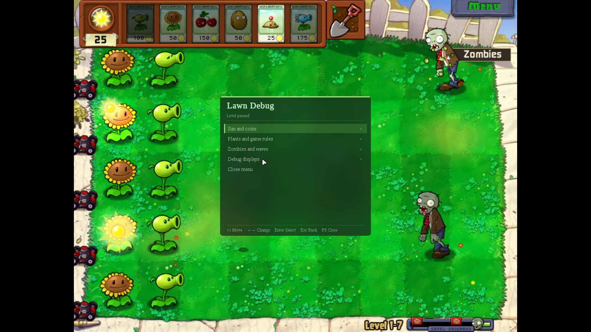
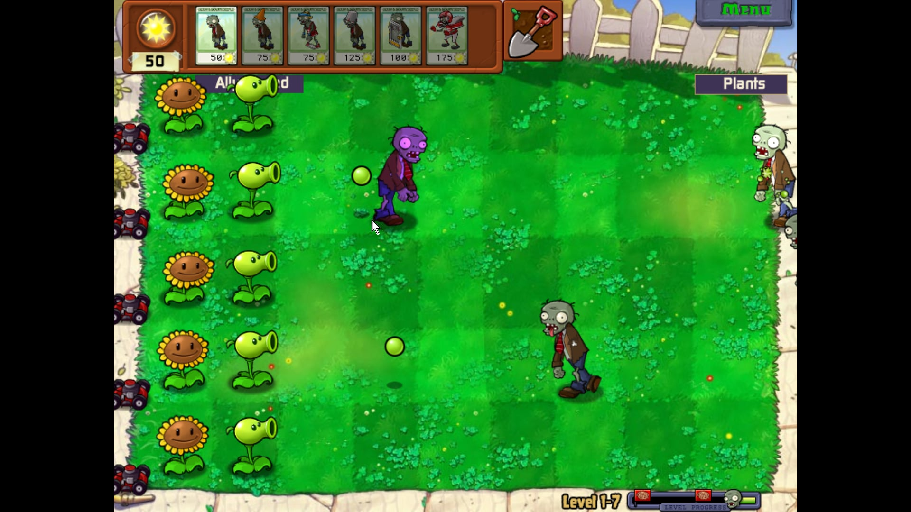

# Lawn Debug for Plants vs. Zombies

Lawn Debug adds an **F9** menu for changing sun, coins, plant and zombie health, game speed, and wave timing. It also adds allied zombie cards to the pre-battle picker and the in-game seed tray.

## Requirements

- **Plants vs. Zombies for Windows, version 1.0.0.1051, 32-bit.** Start with a working installation and its original `PlantsVsZombies.exe`. The installer checks the exact executable by SHA-256.
- **Python 3.10 or newer** to run the installer. On Windows, install Python and confirm that `py -3 --version` works in a new PowerShell window. [Python downloads for Windows](https://www.python.org/downloads/windows/)
- **On Linux or another non-Windows system**, use a Wine or Proton setup that already runs this 32-bit game. Install Python on the host system and run the installer there.

## Install on Windows

1. Close the game. In File Explorer, locate the folder containing `PlantsVsZombies.exe` and `main.pak`. Use a game folder your account can write to.
2. Download `pvz-debug-install.zip` from this repository's **Releases** page and extract it.
3. Open the extracted folder in File Explorer. Type `powershell` in the address bar and press Enter. Run this command with the path to your game folder.

   ```powershell
   py -3 .\build.py --install "C:\Games\Plants vs Zombies"
   ```

   If your Python installation provides `python` instead of `py`, replace `py -3` with `python`.

4. Open `PlantsVsZombies.Debug.exe` in the game folder. Keep `PvzDebug.dll` alongside it and press **F9** in the game. You can still launch `PlantsVsZombies.exe` for the original game.

## Install on Linux with Wine or Heroic

Extract the same release ZIP and open a terminal in the extracted folder. Run the installer with your game folder path.

```bash
python3 ./build.py --install "/path/to/Plants vs Zombies"
```

- **Wine**. From the game folder, run `wine ./PlantsVsZombies.Debug.exe` using the Wine prefix that normally runs the game.
- **Heroic**. For a game you added manually, open the game page's three-dot menu, choose **Edit App/Game**, and set the executable to `PlantsVsZombies.Debug.exe`. For a launcher-managed installation, use **Select an alternative EXE to run** in the game settings. Keep your existing Wine or Proton runner and prefix. [Heroic launcher guide](https://github.com/Heroic-Games-Launcher/HeroicGamesLauncher/wiki/Game-Workarounds), [Heroic custom game settings](https://github.com/Heroic-Games-Launcher/HeroicGamesLauncher/issues/3650)

## Using the mod

Press **F9** at the main menu or in a level. Use **Up** and **Down** to move, **Left** and **Right** to change a setting, **Enter** to select, and **Esc** to go back.

- **Plants and game rules** includes free planting, instant recharge, invulnerable plants, instant Chomper swallow, and **Unlock all plants**. Plant unlocks apply in the card picker without changing your Adventure progress.
- **Zombies** switches the card picker or in-game tray on supported Adventure and Survival boards. Choose your allies before the level, then select a card and click a lawn tile during battle. Sun is charged when you place the ally.
- **Keep settings between levels** is off by default. Turn it on to carry debug rules into new levels and future launches. Actions such as adding sun and spawning a zombie apply once.

## In-game screenshots

### F9 debug menu



### Allied zombie cards



## Verify or remove the installation

If the installer rejects the game version, check the original EXE in PowerShell with `Get-FileHash .\PlantsVsZombies.exe -Algorithm SHA256` from the game folder. On Linux, run `sha256sum PlantsVsZombies.exe`. The supported build has this hash.

```text
f9669af338964787a3785a7895791297d599295b8bb669b0db49443f736a1322
```

To remove the mod, close the game, switch any launcher shortcut back to `PlantsVsZombies.exe`, and remove `PlantsVsZombies.Debug.exe` and `PvzDebug.dll` from the game folder. Remove `PlantsVsZombies.Debug.ini` if you also want to clear the mod's saved settings.

## Build from source

The source build uses Python, Clang, `lld-link`, and Wine's development headers and 32-bit Windows import libraries. Place a copy of the original `PlantsVsZombies.exe` next to `build.py` and run `python3 build.py`. If the repository is inside your game installation, the script can also use the original executable one folder up. If your Wine files are in different locations, set `PVZ_WINE_INCLUDE` to the directory containing the `windows` and `msvcrt` headers and `PVZ_WINE_LIBS` to the directory containing the 32-bit `libkernel32.a`, `libuser32.a`, and `libgdi32.a` libraries.

The install archive contains the patch script and mod DLL. The installer creates the debug EXE locally from your installed copy of the game.
